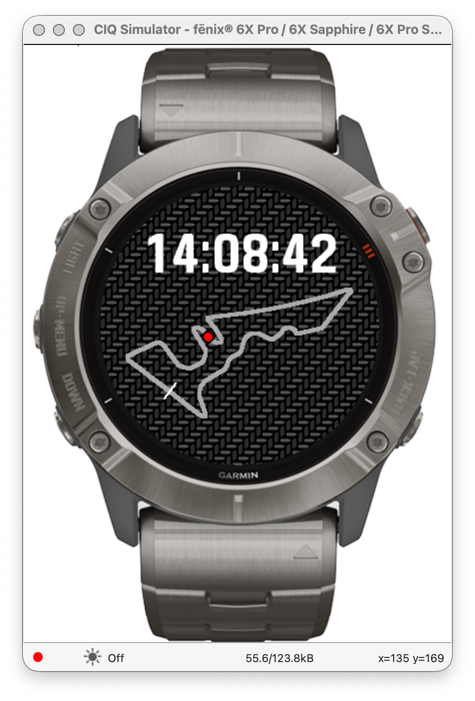

# COTA Watch Face

A Garmin Connect IQ watch face showing the Circuit of the Americas track map. A dot laps the circuit once a minute as the seconds indicator, and the time is shown in 24h `HH:MM:SS` on a carbon fiber background.



Supported devices: fenix 6X Pro / Sapphire (`fenix6xpro`) and fenix 8 47mm AMOLED (`fenix847mm`).

## Build

Requires the Connect IQ SDK and a developer key.

```sh
monkeyc -f monkey.jungle -d fenix6xpro -o bin/COTA-fenix6xpro.prg -y /path/to/developer_key -r
```

## Install

Copy `bin/COTA-<device>.prg` to `GARMIN/APPS/` on the watch over USB (on macOS use [OpenMTP](https://openmtp.ganeshrvel.com/)), then pick it under Watch Face on the watch.

## Notes

- Track outline: OpenStreetMap `highway=raceway` ways, © OpenStreetMap contributors, [ODbL](https://opendatacommons.org/licenses/odbl/). Simplified to 105 points in `source/track-garmin-watchfaceView.mc`.
- Carbon backgrounds are generated by `python3 tools/gen_carbon.py` (needs Pillow).
- On the fenix 6X, seconds keep running in always-on mode via `onPartialUpdate`. On the fenix 8 AMOLED, always-on mode shows only a dimmed `HH:MM`.
